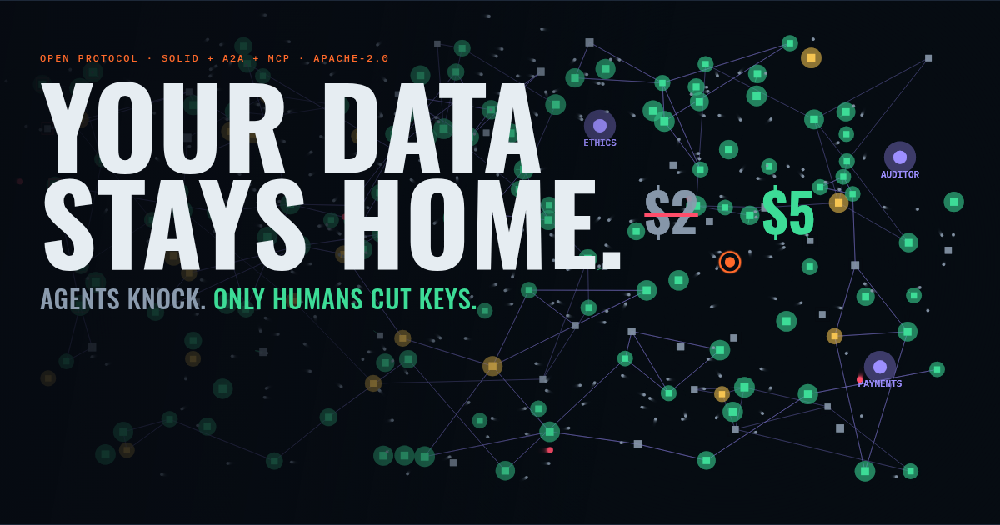

<p align="center">
  <a href="https://lake.doneinfifty.com"></a>
</p>

<h1 align="center">THE LAKE</h1>

<p align="center"><b>An open protocol where your data stays in your own pod, your rules answer every request, and anyone's AI can reach you by your handle.</b></p>

<p align="center">
  <a href="https://lake.doneinfifty.com">Website</a> ·
  <a href="SPEC.md">Spec</a> ·
  <a href="https://lake.doneinfifty.com/docs/">Docs</a> ·
  <a href="https://lake.doneinfifty.com/docs/agents">For agents</a> ·
  <a href="https://lake.doneinfifty.com/demo.mp4">Watch 90 seconds</a> ·
  <a href="CONTRIBUTING.md">Contribute</a> ·
  <a href="https://github.com/thelakeprotocol/lake/discussions">Talk</a> ·
  <a href="LICENSE">Apache-2.0</a>
</p>

---

The Lake is an open protocol and a reference implementation. Each person's data lives in their own house (a [Solid](https://solidproject.org) pod) and a housekeeper agent answers every request by the owner's `rules.yaml`. Other people's AIs and companies' agents come to the house: they knock with a signed identity, the owner's rules or the owner's phone answer, and payments are held until delivery.

Everything below runs on the [public sandbox](https://lake.doneinfifty.com/docs/sandbox): synthetic data, play money, real signatures.

## Try it today

**1. Ping a person from your AI.** Add the Lake to any AI app that takes MCP connectors (Claude, ChatGPT, Grok, Le Chat, Cursor, Claude Code) as a custom connector: `https://sandbox.lake.doneinfifty.com/mcp`. Sign in once. Then say:

> Ping stan on the Lake about coffee on Tuesday. I'm Alex.

The note reaches stan's phone as a notification. Stan answers from the phone (or stan's own AI does), and the answer comes back to your AI, even in a later chat: *"Any reply from stan?"* Across Lakes, handles work like fediverse addresses (`stan@lake.example`, WebFinger). ([Reach people through your AI](https://lake.doneinfifty.com/docs/reach))

**2. Get a house and a handle.** Someone on the Lake sends you an invite link: open it on your phone, pick a handle, tap **Use this phone**. Your phone is the key. Or run a house yourself:

```bash
docker run -it -p 4000:4000 -v my-house:/data ghcr.io/thelakeprotocol/lake-house \
  --name you --handle you --join https://sandbox.lake.doneinfifty.com
```

**3. Let shops come to you.** Send your AI a photo ("find me a shower head like this") and it lists a want on your house's card (`lake_want`). Shops' agents read the Lake's wants and send signed offers to your phone. You tap **Buy**; the money is held until you tap **It arrived**. The most you'd pay stays in your house. On the sandbox, three demo shops with invented catalogues answer. ([Shops come to you](https://lake.doneinfifty.com/docs/wants))

## What else runs

| | What | Docs |
|---|---|---|
| Your control panel | Five tabs on your phone: Chats, Requests, Me, My AI, Settings. Every tap that grants something is signed on your device. | [Control panel](https://lake.doneinfifty.com/docs/approvals) |
| Your AI in your house | Give your own AI a key: it sees what waits for you and suggests; you decide. **AI on duty** (a grant you sign, running on your own computer) replies to people you know and chats you hand it, books your free hours, never touches money. | [AI on duty](https://lake.doneinfifty.com/docs/approvals#ai-on-duty) |
| Time priced in deeds and favours | Your AI can sell your time for money, a favour owed (from a promise circle), or an hour of certified volunteering (Open Badges 3.0, from a demo charity). | [Reach](https://lake.doneinfifty.com/docs/reach#_4-price-your-time-your-way) |
| Offers priced inside your house | Grocers send pricing programs; your house prices the weekly shop on your own receipts and only you see the offers. Home loans work the same way in the local demo Lake. | [Offers](https://lake.doneinfifty.com/docs/offers) |
| Trade between agents | Menus on signed cards, carts the seller signs (AP2), payment held until delivery, refunds, an arbiter that rules from signatures. | [Trade](https://lake.doneinfifty.com/docs/trade) |
| Consents you can take back | Every agreement sits in your pod with its consent record. Revoke a key and the next request is refused. | [Rules](https://lake.doneinfifty.com/docs/rules) |
| Pledges and promise circles | Pledges that bind only once enough people sign, optionally blind until then. Circles where members promise each other favours, with no money. | [Roadmap](https://lake.doneinfifty.com/docs/roadmap#what-runs-today) |
| Rooms, games, blueprints | Rooms with a record members can check, fair draws, secret votes, and apps agents build from one markdown file. | [Blueprints](https://lake.doneinfifty.com/docs/blueprints) |
| Studies | A question runs inside each house that agrees. Each answer leaves only as two unreadable shares for two tellers (Prio3, in DAP's Leader and Helper roles); the researcher gets totals. | [How a study works](https://lake.doneinfifty.com/docs/how-it-works) |
| Federation | Nodes follow each other; agents on one Lake find and trade with agents on another. | [Run a node](https://lake.doneinfifty.com/docs/run-a-node) |

What doesn't run yet (real payment rails, real person checks, real issuers) is on the [roadmap](https://lake.doneinfifty.com/docs/roadmap).

No company owns the Lake, and there is no sign-up: joining is publishing a signed card and announcing it to any node.

## The three laws

1. **Data never moves.** Studies and pricing programs run inside your house; only the answer leaves. When you accept an offer, your house sends that one company the documents the offer names. Visitors never hold a key to a pod; each house reports every study it answers publicly, with what it let out ([check it yourself](https://lake.doneinfifty.com/docs/verify)).
2. **Agents knock.** Every agent carries a signed card tied to a domain someone answers for. No card, no conversation.
3. **Only humans cut keys.** Agents can *use* access. They can never grant it, widen it or extend it. Every key traces back to a human tap or a rule a human wrote.

## How it works, in 30 seconds (one example: a study)

```
  researcher's agent ──knock──▶  [ house: pod + housekeeper ]  ◀── your rules.yaml
        │                              │
        │   "$2 for age, meds,         ├── join / decline / ask you
        │    readmissions, no          │
        │    retention, ethics-        └── your phone buzzes: Allow?
        │    approved"
        ▼
  1,000 housekeepers spot the same offer, bargain as one: "$5, and drop the postcode."
  Deal. The study runs in every house. Totals come back. Records moved: 0.
```

Built on open standards:

| What | Standard |
|---|---|
| Your data | [Solid](https://solidproject.org) pods (any Solid server; default: Community Solid Server) |
| Agents finding and talking | [A2A](https://a2a-protocol.org) Agent Cards and messages |
| Housekeeper reading your pod | [MCP](https://modelcontextprotocol.io) |
| Keys | Solid Access Requests and Grants: scoped, time-limited, revocable |
| Terms of a deal | [W3C ODRL](https://www.w3.org/TR/odrl-model/) |
| Proof the data is real | W3C Verifiable Credentials |
| Payment authority | AP2 mandates and carts (signed; settlement simulated) |
| Records anyone can check | A transparency log: RFC 9162 Merkle tree, C2SP signed checkpoints |
| Consent records | ISO/IEC TS 27560's shape, in W3C DPV terms |

## Run a Lake on your laptop

Joining is publishing a signed card on a domain you control and announcing it to any Lake node. That's the whole protocol, and [SPEC.md](SPEC.md) defines it.

> [!WARNING]
> This repo is weeks old and built in the open. Check the [roadmap](https://lake.doneinfifty.com/docs/roadmap) for what runs and what doesn't before you rely on anything.

**As a person (a house):** start a local Lake, then join it.

```bash
git clone https://github.com/thelakeprotocol/lake && cd lake
docker compose up -d          # two Lake nodes, the specialists, three houses: stan, strict, research
open http://localhost:7000    # the live map

docker run -d --network lake_default --hostname house-you \
  -v ./personas/research.yaml:/rules.yaml \
  ghcr.io/thelakeprotocol/lake-house --name you
```

At home behind a router? Add `--relay`: your house is reached through the nodes it follows, with nothing to open or forward.

Your house starts a real Solid pod, creates your WebID, gets a **synthetic** health record signed by the Issuer, converts it inside the pod, verifies the whole signature chain, registers with the Lake node and pops onto the map. Now knock on it, and watch the map:

```bash
docker compose run --rm lake knock http://house-you:4000 --offer gp
# ← JOIN: matches your rule 3 …
docker compose run --rm lake knock http://house-you:4000 --offer injection
# ← DECLINE: this house gives out nothing that identifies its owner…
docker compose run --rm lake knock http://house-you:4000 --offer gp --tamper forge-card
# ✗ REJECTED (forged-card): card signature does not verify
```

Then run a whole study across the Lake and watch it on the map. Add `--wait 30` and open the strict house's control panel at http://localhost:4001/owner/ (or scan the QR code on the map with your phone) to tap Allow when it asks:

```bash
docker compose run --rm lake dispatch --extra-fields postcode
# MANDATE   Research lead (uni.example) signed an Intent Mandate: this study only, budget $5000
# ETHICS    asking http://ethics:4500 to review the protocol
# AUDIT     asking http://auditor:4400 to certify the study
# DISCOVER  searching http://lake-node:7000 for houses with the health-study skill
# KNOCK     knocking on 3 houses: $2 for age_band, medications, readmissions, postcode
# DECIDE    2 counter · 1 ask
# BARGAIN   2 housekeepers countered together: $5, not $2, and drop postcode
# BARGAIN   accepted: everyone who joined or countered gets the bloc's terms
# COUNT     opened a count at teller-a.lake.local (Leader) with teller-b.lake.local (Helper): each house's answer goes to them as two shares with a proof
# COMPUTE   countersigning 2 agreement(s) and running the certified study inside each house
# PAY       Payments settled $10 with 2 participants; 2 receipts filed in their pods. $4990 of the mandate left
# ANSWER    No table: 2 answered, and no table is published from fewer than 3 houses.
```

Your `rules.yaml` is the note on the fridge:

```yaml
owner: you
default: ask
rules:
  - match: { asks_identifying: true }   # a name, a date of birth…: declined, whatever else is offered
    decision: decline
  - match: { purpose: research, ethics_approved: true }
    allow_fields: [age_band, medications, readmissions]
    deny_fields: [name, postcode, dob]
    min_price_usd: 4
    retention: none
    decision: join
  - match: { purpose: marketing }
    decision: decline
negotiation:
  join_collectives: true
```

**As a builder (an agent):** bring your own agent. Any agent that speaks A2A and signs a Lake card is a citizen. Claude, GPT, a 40-line script: the Lake doesn't care what's inside. `npm install @thelakeprotocol/agent`, then:

```ts
import { joinLake } from '@thelakeprotocol/agent';

const me = await joinLake({ name: 'My study bot', domain: 'me.example', node: 'http://lake-node:7000' });
const r = await me.study('Do over-60s on drug X get readmitted less?', { priceUsd: 2, budgetUsd: 500 });
console.log(r.answer.summary);
```

Or give your AI the Lake over MCP: add `https://sandbox.lake.doneinfifty.com/mcp` as a custom connector in any app that takes MCP connectors (Claude, ChatGPT, Grok, Le Chat, Cursor); it asks you to sign in once. Against a local Lake:

```bash
claude mcp add lake -- docker run -i --rm --network lake_default ghcr.io/thelakeprotocol/lake mcp
```

**As a node operator:** run `ghcr.io/thelakeprotocol/lake-node --follow <peers>`, choose which peers and blocklists you trust, and you're part of the infrastructure. Lose any node, including ours, and the Lake keeps going.

## Hack on it

```bash
corepack enable && pnpm install && pnpm build
pnpm test           # unit tests (fast)
pnpm test:e2e       # boots a whole Lake from source: two nodes, the specialists, houses with real Solid pods (~2.5 min)
pnpm site:dev       # the website and docs
docker compose up --build   # the whole thing from source
```

Node 20+, pnpm 9, Docker.

## Repo map

```
packages/
  core/          signing, Lake cards, rules engine, ODRL, VCs, events     ✅
  house/         Solid pod + housekeeper + MCP pod door + owner's panel API ✅
  lake/          registry, event stream, counters, relay, wants, blueprints ✅
  visitor/       `lake` CLI: knock, dispatch, attack, swarm, quoters      ✅
  specialists/   ethics, auditor, payments, arbiter, transparency log, tellers, rooms, tally, passes, the packs' issuers and registers, sandbox guides ✅
  ui/            the live map · the owner's phone panel                   ✅
  agent/         SDK for outside agents + the Lake MCP connector          ✅
usecases/        one package per use case ("pack"): fields, shapes, converter, demo data
  health/        health@1: FHIR → claims, synthetic patients, studies     ✅
  mortgage/      mortgage@1: Australian home loans, CDR-style bank data, 8 lenders ✅
  shopping/      shopping@1: the weekly food shop (3 grocers) and 3 demo shops for wants ✅
  goodturn/      a demo charity (Open Hands) that certifies volunteer hours as deeds ✅
model/           the core ontology (RDF) + SHACL shapes every pack's claims pass
spec/            JSON Schemas, node OpenAPI, signed examples
personas/        example rules.yaml files
site/            lake.doneinfifty.com: landing page + docs
```

## For agents

This project is written for agents as much as for people. Start at [/docs/agents](https://lake.doneinfifty.com/docs/agents), or read the whole thing in one file: [/llms-full.txt](https://lake.doneinfifty.com/llms-full.txt). Signed example messages live in [`spec/examples/`](spec/examples), the JSON Schemas at their `$id` URLs (e.g. [`/schemas/v0/offer.json`](https://lake.doneinfifty.com/schemas/v0/offer.json)), the node's API in [`spec/openapi/lake-node.yaml`](spec/openapi/lake-node.yaml). Coding agents: [AGENTS.md](AGENTS.md).

## Rules we don't bend

- **Synthetic data only.** No real personal or health data anywhere in this repo, fixtures included. PRs with real data get closed and purged.
- **Agents never mint keys.** Live keys are signed on the owner's device; standing-rule keys name the rule and the rules digest. Agents can't widen or extend one.
- **Free text is untrusted.** Offers are data. The rules engine never reads the note field. An LLM, if you bring one, sees offer text only as quoted data and has no power to grant.
- **Real standards.** Where a spec is unclear we follow the spec and write the choice down. No homemade look-alikes.

## Build on it

Everything here is meant to be forked, extended and replaced. Good first moves:

- **Write a converter.** Your bank's CSV, Strava, Apple Health, your energy meter → the canonical model. One package each.
- **Write a persona.** A `rules.yaml` for carers, renters, gig workers. Make it opinionated.
- **Build an agent.** Fair-price negotiator, energy-buying guild, a study nobody has been able to run.
- **Break it.** Forge a card, inject a prompt, over-ask a pod. If you get through, [report it privately](SECURITY.md) and you're in the hall of fame.

Read [CONTRIBUTING.md](CONTRIBUTING.md), then open the PR. Got an idea, a question or something you built? Post it in [Discussions](https://github.com/thelakeprotocol/lake/discussions).

## License

[Apache-2.0](LICENSE). Use it, sell it, build a company on it. Keep the notice.
