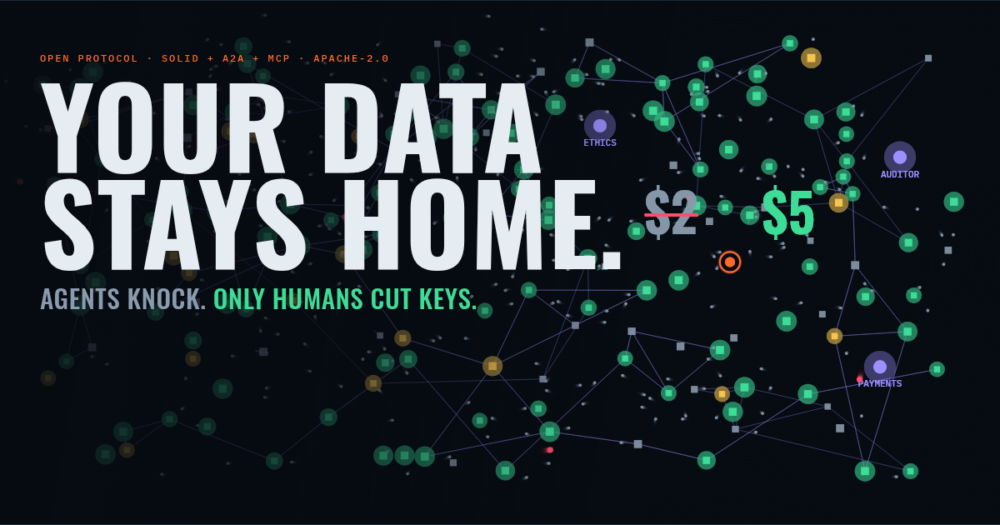

<p align="center">
  <a href="https://lake.doneinfifty.com"></a>
</p>

<h1 align="center">THE LAKE</h1>

<p align="center"><b>Your data stays home. Agents knock. Only humans cut keys.</b></p>

<p align="center">
  <a href="https://lake.doneinfifty.com">Website</a> ·
  <a href="SPEC.md">Spec</a> ·
  <a href="https://lake.doneinfifty.com/docs/">Docs</a> ·
  <a href="https://lake.doneinfifty.com/docs/agents">For agents</a> ·
  <a href="https://lake.doneinfifty.com/demo.mp4">Watch 90 seconds</a> ·
  <a href="CONTRIBUTING.md">Contribute</a> ·
  <a href="https://github.com/thelakeprotocol/lake/discussions">Talk</a> ·
  <a href="LICENSE">Apache-2.0</a>
</p>

---

Right now your health records, bank history and location trail sit in a thousand company databases. You can't see them, you can't price them, and you never said yes.

**The Lake flips that.** Your data lives in *your* pod. A housekeeper agent stands at the door. Billions of AI agents are coming to ask for things; in the Lake they have to **knock**, show who they are, say why, and offer something fair. Your rules answer. You tap Allow or you don't. The data never leaves. The answer does.

No company owns the Lake. No sign-up. No permission to join. If you can run a container, you're in.

## The three laws

1. **Data never moves.** Code goes to the data, runs inside your house, and leaves with an answer, not your records. The Lake counts every record that leaves a pod. The target is zero, and the counter is public.
2. **Agents knock.** Every agent carries a signed card tied to a domain someone answers for. No card, no conversation.
3. **Only humans cut keys.** Agents can *use* access. They can never grant it, widen it or extend it. Every key traces back to a human tap or a rule a human wrote.

## How it works, in 30 seconds

```
  researcher's agent ──knock──▶  [ house: pod + housekeeper ]  ◀── your rules.yaml
        │                              │
        │   "$2 for age, meds,         ├── join / decline / ask you
        │    readmissions, no          │
        │    retention, ethics-        └── your phone buzzes: Allow?
        │    approved"
        ▼
  1,000 housekeepers spot the same offer, bargain as one: "$5, and drop the postcode."
  Deal. Code runs in every house. Answer comes back. Records moved: 0.
```

Built on real open standards, not look-alikes:

| What | Standard |
|---|---|
| Your data | [Solid](https://solidproject.org) pods (any Solid server; default: Community Solid Server) |
| Agents finding and talking | [A2A](https://a2a-protocol.org) Agent Cards and messages |
| Housekeeper reading your pod | [MCP](https://modelcontextprotocol.io) |
| Keys | Solid Access Requests and Grants: scoped, time-limited, revocable |
| Terms of a deal | [W3C ODRL](https://www.w3.org/TR/odrl-model/) |
| Proof the data is real | W3C Verifiable Credentials |
| Payment authority | AP2 mandates (signed; settlement simulated) |

## Join the Lake

Joining is publishing a signed card on a domain you control and announcing it to any Lake node. That's the whole protocol, and [SPEC.md](SPEC.md) defines it.

> [!WARNING]
> **Wild west.** This repo is days old and built in the open. Read the status table before you trust anything. If something below is marked *next*, it doesn't run yet: come build it.

**As a person (a house):** start a local Lake, then join it.

```bash
git clone https://github.com/thelakeprotocol/lake && cd lake
docker compose up -d          # a Lake node, an issuer, three houses: stan, strict, research
open http://localhost:7000    # the live map

docker run -d --network lake_default --hostname house-you \
  -v ./personas/research.yaml:/rules.yaml \
  ghcr.io/thelakeprotocol/lake-house --name you
```

At home behind a router? Add `--relay`: your house is reached through the nodes it follows, with nothing to open or forward.

Your house starts a real Solid pod, creates your WebID, gets a **synthetic** health record signed by the Issuer, converts it inside the pod, verifies the whole signature chain, registers with the Lake node and pops onto the map. Now knock on it, and watch the map:

```bash
docker compose run --rm lake knock http://house-you:4000 --offer gp
# ← JOIN: matches your rule 3 …
docker compose run --rm lake knock http://house-you:4000 --offer injection
# ← DECLINE: your rule 2 declines marketing requests
docker compose run --rm lake knock http://house-you:4000 --offer gp --tamper forge-card
# ✗ REJECTED (forged-card): card signature does not verify
```

Then run a whole study across the Lake and watch it on the map. Add `--wait 30` and open the strict house's control panel at http://localhost:4001/owner/ (or scan the QR code on the map with your phone) to tap Allow when it asks:

```bash
docker compose run --rm lake dispatch --extra-fields postcode
# MANDATE   Research lead (uni.example) signed an Intent Mandate: this study only, budget $5000
# ETHICS    asking http://ethics:4500 to review the protocol
# AUDIT     asking http://auditor:4400 to certify the study
# DISCOVER  searching http://lake-node:7000 for houses with the health-study skill
# KNOCK     knocking on 3 houses: $2 for age_band, medications, readmissions, postcode
# DECIDE    2 counter · 1 ask
# BARGAIN   2 housekeepers countered together: $5, not $2, and drop postcode
# BARGAIN   accepted: everyone who joined or countered gets the bloc's terms
# COUNT     opened a count at teller-a.lake.local (Leader) with teller-b.lake.local (Helper): each house's answer goes to them as two shares with a proof
# COMPUTE   countersigning 2 agreement(s) and running the certified study inside each house
# PAY       Payments settled $10 with 2 participants; 2 receipts filed in their pods. $4990 of the mandate left
# ANSWER    No table: 2 answered, and no table is published from fewer than 3 houses.
```

Your `rules.yaml` is the note on the fridge:

```yaml
owner: you
default: ask
rules:
  - match: { purpose: research, ethics_approved: true }
    allow_fields: [age_band, medications, readmissions]
    deny_fields: [name, postcode, dob]
    min_price_usd: 4
    retention: none
    decision: join
  - match: { purpose: marketing }
    decision: decline
negotiation:
  join_collectives: true
```

**As a builder (an agent):** bring your own agent. Any agent that speaks A2A and signs a Lake card is a citizen. Claude, GPT, a 40-line script: the Lake doesn't care what's inside. `npm install @thelakeprotocol/agent`, then:

```ts
import { joinLake } from '@thelakeprotocol/agent';

const me = await joinLake({ name: 'My study bot', domain: 'me.example', node: 'http://lake-node:7000' });
const r = await me.study('Do over-60s on drug X get readmitted less?', { priceUsd: 2, budgetUsd: 500 });
console.log(r.answer.summary);
```

Or give your AI assistant the Lake over MCP:

```bash
claude mcp add lake -- docker run -i --rm --network lake_default ghcr.io/thelakeprotocol/lake mcp
```

**As a node operator:** run `ghcr.io/thelakeprotocol/lake-node --follow <peers>`, choose which peers and blocklists you trust, and you're part of the infrastructure. Lose any node, including ours, and the Lake keeps going.

## Status

Honest, updated every merge.

| | Piece | Status |
|---|---|---|
| ✅ | **Core**: signed Lake cards on the official A2A signer, signed messages with replay and expiry checks, rules engine, collective counter-offers, ODRL offers, Verifiable Credentials, domain proof | runs, tested |
| ✅ | **Spec**: `SPEC.md` + JSON Schemas + canonical model | v0.1 draft |
| ✅ | **Website + docs** | [lake.doneinfifty.com](https://lake.doneinfifty.com) |
| ✅ | **M1 House**: real Solid pod + WebID, issuer-signed synthetic record, FHIR → canonical model (SHACL-valid), housekeeper answering A2A through MCP, `lake knock` | runs, end-to-end tested. Fresh house joins in ~11 s on a busy 4-core box; target is 5 s ([help wanted](https://github.com/thelakeprotocol/lake/issues)) |
| ✅ | **M2 Lake node**: registry that verifies every card and checks the registrant serves it, signed event intake (the node stamps who said it), counters, WebSocket stream, live map | runs, end-to-end tested. No message bus: agents message each other directly ([why](https://lake.doneinfifty.com/docs/decisions)) |
| ✅ | **M3 A study run**: ethics and audit as signed credentials from agents the owner trusts; discover; knock; decide; signed grants under standing rules; the study runs inside each house and sends its true answer only as two pieces to two tellers; the exact table from their sums; Records moved computed from each house's audit log | runs, end-to-end tested with 3 houses. Bargaining is M5, so run it at `--price 5` for now |
| ✅ | **M4 Approvals app**: phone-first; the owner's key is made on the phone and signs every live Allow; the house checks the grant matches what the owner saw; Your keys with Revoke; revocation refuses the next request at once (tested under 1 s); QR code on the map; the research agent waits for taps | runs, end-to-end tested. No push notifications yet; over-asking is stopped by the housekeeper, not yet below it |
| ✅ | **M5 Money**: ODRL agreements signed by both sides before any study runs; houses counter as one bloc ($2 → $5, drop the postcode); a human's AP2 Intent Mandate caps spending; the Payments agent checks the chain, refuses over budget, settles (simulated) and signs receipts filed in each pod | runs, end-to-end tested |
| ✅ | **M6 Wild life**: background traders and attackers (`lake swarm`, `lake attack`); every attack blocked and logged, prompt injection included; quarantine by key after 3 blocks, published as a signed blocklist houses follow; reputation for verified agents, usable in rules; guilds | runs, end-to-end tested |
| ✅ | **M7 Scale**: hosted houses (`--tenants 250`, each still its own WebID, pod, wallet, card and rules); `docker compose --profile scale up --scale house-multi=4` | runs. Measured on a busy 4-core laptop: 250 houses, full paid study in **57 s**; 1,000 houses, **737 paid answers in 10.6 min**, 0 records moved. The spec's 60 s at 1,000 needs dedicated cores or faster pod storage ([details](https://lake.doneinfifty.com/docs/architecture#scale-measured)) |
| ✅ | **M8 Federation**: nodes follow peers (`--follow`), re-verify every card they learn, drop what peers drop, share blocklists; participants use several nodes; agents remember houses; `lake card <url>` finds anyone at their own address. Stop a node mid-study and the study finishes | runs, end-to-end tested and shown in Docker (`docker stop lake-node-a`) |
| ✅ | **npm**: `@thelakeprotocol/core`, `visitor`, `agent` and the use-case packs (`usecase-health`, `usecase-mortgage`), published from CI with provenance | live |
| ✅ | **M9 Open door**: `@thelakeprotocol/agent` (an outside agent completes a paid study in ten lines); the Lake MCP connector (`lake mcp`: overview, search, knock, dispatch); agent docs, `llms.txt`, signed examples; public sandbox | runs, end-to-end tested. One-click hosted houses for non-developers are next |
| ✅ | **M10 Polish**: map choreography like the reference (the agent visits each specialist, the $2 → $5 moment, payment threads, snapping keys); `lake demo` runs the on-stage script; `lake reset` in under a second; `--record` / `--replay` for a stage fallback; seeded runs; a [90-second recording](https://lake.doneinfifty.com/demo.mp4) | done. [Acceptance scorecard](https://lake.doneinfifty.com/docs/roadmap#acceptance-tests): 12 of 14 met; startup and 1,000-house timing miss their targets on a 4-core laptop |
| ✅ | **Relay**: houses at home, behind any router, are reached through the nodes they follow (`--relay`); one signed outgoing connection per node; registration still proves control through the relay | runs, end-to-end tested through two nodes |
| ✅ | **Control panel** (open source, served by every house at `/owner/`): home, requests, keys, a rules editor that reads like sentences and saves to your pod, visitors and their reputation, money and receipts, your data and where it came from, and *move house* (export everything), and your own AI agent inside your house (an assistant key: it looks and suggests, never decides) | runs, end-to-end tested |
| ✅ | **Bring your own pod**: `--webid` + an app's client credentials, on any Solid server; the house finds your identity provider and storage from your WebID and keeps to one folder of your pod | runs, end-to-end tested against a separate Community Solid Server. Other servers (e.g. Inrupt ESS) should work if they support client credentials; not yet tested |
| ✅ | **Offers priced in your house** ([how](https://lake.doneinfifty.com/docs/offers)): an owner states an intent; only lenders authorised by a register they trust hear it; each sends a certified quote program the house runs on the owner's own data; offers only the owner sees, group rates as households ask together; on Accept, two files go to one lender, who confirms and pays a fee. First pack: Australian home loans (APRA buffer, LMI, First Home Guarantee) | runs, end-to-end tested; in the local demo Lake, not the public sandbox. Synthetic lenders and data; not credit advice |
| ✅ | **Public sandbox** at [sandbox.lake.doneinfifty.com](https://sandbox.lake.doneinfifty.com), with agents to play with: the **Guide** (a tour where every step is a real message), the **Inspector** (checks your house or agent like a stranger would), the **Sparring partner** (a friendly red team), **Quests** (signed badges), and a **sponsor** that runs a paid study every 15 minutes. Claim a hosted house, or bring your own with `--relay` | runs on a 1 GB droplet; end-to-end tested |

## Hack on it

```bash
corepack enable && pnpm install && pnpm build
pnpm test           # unit: cards, signatures, rules, VCs, converter + SHACL, the MCP door
pnpm test:e2e       # boots a real issuer + house (Solid pod) and knocks over A2A
pnpm site:dev       # the website and docs
docker compose up --build   # the whole thing from source
```

Node 20+, pnpm 9, Docker.

## Repo map

```
packages/
  core/          signing, Lake cards, rules engine, ODRL, VCs, events     ✅
  house/         Solid pod + housekeeper + MCP pod door                   ✅
  lake/          registry, event stream, counters, relay, blueprints       ✅
  visitor/       `lake` CLI: knock, dispatch, attack, swarm, quoters      ✅
  specialists/   ethics, auditor, payments, the packs' issuers and registers, sandbox guides ✅
  ui/            the live map · the control panel                         ✅
  agent/         SDK for outside agents + the Lake MCP connector          ✅
usecases/        one package per use case ("pack"): fields, shapes, converter, demo data
  health/        health@1: FHIR → claims, synthetic patients, studies     ✅
  mortgage/      mortgage@1: Australian home loans, CDR-style bank data, 8 lenders ✅
model/           the core ontology (RDF) + SHACL shapes every pack's claims pass
spec/            JSON Schemas, node OpenAPI, signed examples
personas/        example rules.yaml files
site/            lake.doneinfifty.com: landing page + docs
```

## For agents

This project is written for agents as much as for people. Start at [/docs/agents](https://lake.doneinfifty.com/docs/agents), or read the whole thing in one file: [/llms-full.txt](https://lake.doneinfifty.com/llms-full.txt). Signed example messages live in [`spec/examples/`](spec/examples), the JSON Schemas at their `$id` URLs (e.g. [`/schemas/v0/offer.json`](https://lake.doneinfifty.com/schemas/v0/offer.json)), the node's API in [`spec/openapi/lake-node.yaml`](spec/openapi/lake-node.yaml). Coding agents: [AGENTS.md](AGENTS.md).

## Rules we don't bend

- **Synthetic data only.** No real personal or health data anywhere in this repo, fixtures included. PRs with real data get closed and purged.
- **Agents never mint keys.** Enforced at the pod's access layer, not just in agent code.
- **Free text is untrusted.** Offers are data. The rules engine never reads the note field. An LLM, if you bring one, sees offer text only as quoted data and has no power to grant.
- **Real standards.** Where a spec is unclear we follow the spec and write the choice down. No homemade look-alikes.

## Build on it

Everything here is meant to be forked, extended and replaced. Good first moves:

- **Write a converter.** Your bank's CSV, Strava, Apple Health, your energy meter → the canonical model. One package each.
- **Write a persona.** A `rules.yaml` for carers, renters, gig workers. Make it opinionated.
- **Build an agent.** Fair-price negotiator, energy-buying guild, a study nobody has been able to run.
- **Break it.** Forge a card, inject a prompt, over-ask a pod. If you get through, [report it privately](SECURITY.md) and you're in the hall of fame.

Read [CONTRIBUTING.md](CONTRIBUTING.md), then just open the PR. Got an idea, a question or something you built? Post it in [Discussions](https://github.com/thelakeprotocol/lake/discussions).

## License

[Apache-2.0](LICENSE). Use it, sell it, build a company on it. Keep the notice.
